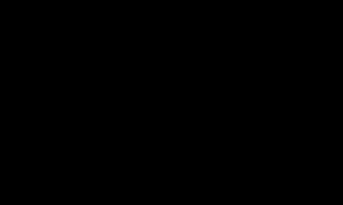

# TRend

TRend turns pixels into terminal output. You draw or decode an RGBA picture; TRend chooses the
characters and colours that show it best in a grid of terminal cells, and writes only the cells
that changed since the last frame.

The core is a small Rust library with **no dependencies**. Everything else (terminal handling,
3D, text, image and video decoding) is an optional crate you add only if you need it.



*The `showcase` example in a 120 × 36 terminal: `trend-3d` draws the ring, `trend-text` the
title, `trend-term` runs the terminal, and the core turns the pixels into cells.*

## Start in fifty lines

```text
cargo run --release -p trend-term --example starter
cargo run --release -p trend-term --example showcase
```

[`adapters/term/examples/starter.rs`](adapters/term/examples/starter.rs) is a complete program:
it opens the terminal, draws an animated picture that follows the window's size, moves a square
with the arrow keys, and exits cleanly. Its heart is this loop; change the `draw` closure to draw
anything:

```rust
let mut session = Session::enter(SessionOptions::new())?;
let info = session.info();
let mut surface = Surface::new(HalfBlock, info.viewport, info.capabilities)?;
surface.set_output_options(info.recommended_output_options());
loop {
    while let Some(event) = session.poll(Duration::ZERO)? {
        match event {
            Event::Resize(viewport) => surface.resize(viewport)?,
            Event::Key { key: Key::Esc, .. } => return Ok(()),
            _ => {}
        }
    }
    surface.draw(|pixels, spec| { /* fill the pixels */ })?;
    session.write_frame(surface.present_bytes())?;
}
```

TRend is not on crates.io yet. Until it is, depend on it from this repository:

```toml
[dependencies]
trend = { git = "https://github.com/DigitalDolos/TRend" }
trend-term = { git = "https://github.com/DigitalDolos/TRend" }
```

## The crates

| Crate | What it gives you | Depends on |
| --- | --- | --- |
| `trend` (`src/`) | Pixels to cells to ANSI bytes: five cell encoders, a `Surface` that presents only what changed, layers and cell text, colour depths from truecolor to monochrome, and a C ABI | nothing |
| [`trend-term`](adapters/term/) | The terminal itself: raw mode, the alternate screen, size and resize, keyboard with held keys, mouse, restore on exit and on panic | `crossterm` |
| [`trend-3d`](adapters/3d/) | Software 3D: glTF/GLB, OBJ, STL and PLY loading, physically based materials, sky boxes, fog, orbit and first-person cameras | `trend` only |
| [`trend-text`](adapters/text/) | Scaled text drawn as pixels: a built-in pixel font and a TrueType rasterizer | `trend` only |
| `trend-image` | Bounded PNG, JPEG, BMP and TIFF decoding (WebP behind a feature) | `png`, `jpeg-decoder`, `image` |
| `trend-animation` | Bounded GIF decoding (animated WebP behind a feature) and timelines | `gif` |
| [`trend-video`](adapters/video/) | Video frames: MP4 on Windows through Media Foundation; WebM and MKV behind features | platform decoders |
| [`trend-media`](adapters/media/) | One way to open any of the above, with seeking and preview sessions | the three decoders |

Nothing in the core depends on any other crate here, and no optional crate is needed to use the
core.

## Ways to use it

**Draw your own pixels.** Create a `Surface` for the terminal's size, draw RGBA pixels into it
(by hand, with `trend-3d` and `trend-text`, or by handing it a frame from your own renderer or a
GPU read-back), and write `surface.present_bytes()` to the terminal. The surface encodes and
sends only what changed. Start from the `starter` example; [docs/usage.md](docs/usage.md) and
[docs/readback-recipes.md](docs/readback-recipes.md) go further.

**Show pictures and video.** Decode with the media crates and render with `Renderer`, which
fits, scales and letterboxes a frame into cells. The test viewer is a complete example:

```text
cargo run -p trend-first-render -- tests/fixtures/media/ColorTest.png
cargo run -p trend-test-viewer -- tests/fixtures/media/ColorTest.gif
```

**From C, C++ or Python.** `include/trend.h` is a small C ABI ([docs/ffi.md](docs/ffi.md)). The
Python examples drive a helper process over pipes ([docs/bridge-protocol.md](docs/bridge-protocol.md)).

TRend stays a renderer in every case: your program keeps its own layout, input, scheduling and
audio. TRend does not decode or play audio; video frames carry timestamps so you can follow your
own audio clock.

## Cell encoders

An encoder decides how many pixels each terminal cell shows and which characters it uses.

| Encoder | Pixels per cell | Characters | Good for |
| --- | --- | --- | --- |
| `HalfBlock` | 1 × 2 | `▀` `▄` | Everything; works in every Unicode terminal |
| `Quadrant` | 2 × 2 | quadrant blocks | Sharper pictures, two colours per cell |
| `Sextant` | 2 × 3 | Unicode 13 sextants | The most detail; needs a recent font |
| `Braille` | 2 × 4 | Braille dots | Line art, plots, wireframes |
| `Density` | 1 × 1 | ` .:-=+*#%@` or shades | ASCII-only and monochrome terminals |

## Requirements

- A current stable Rust toolchain.
- A terminal that understands ANSI escape sequences, such as Windows Terminal or any modern
  Unix terminal. Truecolor looks best; 256, 16 and monochrome output are supported.
- For video on Windows: Windows 10 or newer. On Linux, the optional video features need
  `pkg-config` and libvpx development files (and an OpenH264 runtime for `linux-h264`).
- Python 3.10 or newer, only for the Python examples.

## Examples

| Run | Shows |
| --- | --- |
| `cargo run --release -p trend-term --example starter` | The smallest complete interactive program |
| `cargo run --release -p trend-term --example showcase` | 3D, scaled text, keyboard and mouse together |
| `cargo run --release -p trend-3d --example model_view -- model.glb` | A 3D model turning in the terminal |
| `cargo run --release -p trend-text --example text_view` | Scaled text at growing sizes |
| `cargo run --release --example surface_demo` | `Surface` with the core alone: drawing, damage and placing an image |
| `cargo run --release --example hud_3d` | A text HUD over a software-rendered scene |
| `cargo run --release -p trend-external-renderer` | Borrowing another renderer's framebuffer without copying |
| `cargo run --release --example frame_budget` | Where a 30 FPS frame's time goes |

## Repository layout

| Path | Purpose |
| --- | --- |
| `src/` | The dependency-free core and its C ABI |
| `adapters/` | The optional crates in the table above |
| `examples/` | Core examples, a first render, an external renderer, and Python hosts |
| `tools/` | The test viewer, the Python bridge, and a Windows GUI lab |
| `tests/` | Golden, differential and regression tests, with their media fixtures |
| `scripts/`, `packaging/` | Build, test, validation and packaging entry points |
| `docs/` | Guides and reference; see [docs/README.md](docs/README.md) |

## Documentation

- [Getting started](docs/getting-started.md) and [usage](docs/usage.md)
- [Rust API reference and feature flags](docs/api.md)
- [Architecture: what TRend owns and what your program owns](docs/architecture.md)
- [C ABI](docs/ffi.md) and the [Python bridge protocol](docs/bridge-protocol.md)
- [Benchmarks](docs/benchmarks.md) and [testing](docs/testing.md)
- [Windows](docs/platforms/windows.md), [Linux](docs/platforms/linux.md) and
  [Android](docs/platforms/android.md) notes
- [Project status](docs/development-status.md) and [roadmap](docs/architecture-roadmap.md)

## Build and verify

```text
cargo build --workspace
cargo test --workspace
cargo clippy --workspace --all-targets -- -D warnings
cargo fmt --all -- --check
```

Windows entry points live under `scripts/` (`build-windows.bat`, `test-windows.bat`,
`validate-repository.ps1`); packages are generated under `dist/`.

## Status

TRend is at version 0.1 and its API can still change. The core and the image, animation and
Windows video paths are covered by tests and have been run on Windows and Linux; Android image
and terminal output have been checked on a device, Android video is not implemented. See
[docs/development-status.md](docs/development-status.md) for what has and has not been verified.

## Contributing and license

See [CONTRIBUTING.md](CONTRIBUTING.md) before submitting changes and
[SECURITY.md](SECURITY.md) to report a vulnerability. TRend is licensed under the
[Apache License 2.0](LICENSE). Third-party obligations are recorded in
[THIRD_PARTY_NOTICES.md](THIRD_PARTY_NOTICES.md).
