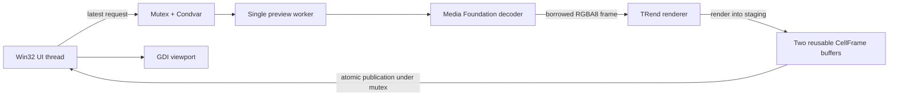

# TRend Native UI Laboratory

This Windows-only lab exercises TRend as an embedded rendering component rather
than a terminal application. It displays PNG, JPEG, and animated GIF cards and
starts a real MP4/H.264 preview when either video card is hovered.

## Run

From the workspace root:

```powershell
cargo run -p trend-ui-lab
```

Controls:

- Hover either video card to open and play it in the preview viewport.
- Move away from video cards or press `Space` to stop and release the decoder.
- Press `1`, `2`, or `3` for FAST, BALANCED, or QUALITY sampling.
- Press `F` for contain or `S` for stretch.
- Resize the window to issue a latest-size-wins render request.
- Press `Esc` to close.

The status line reports decode and render latency, decoded and decoder-dropped
frames, stale renders, replaced publications, retained decoder bytes, cell
buffer bytes, and active decoder count.

## Architecture



The UI thread owns the Win32 event loop and all GDI painting. One worker owns at
most one `VideoDecoder`. Each update replaces the pending request and increments
an atomic generation; cancellable rendering drops work from older generations.
Publication swaps a staging `CellFrame` with the displayed frame, so steady-state
preview rendering does not allocate a new cell buffer per frame.

Hovering a new video drops the previous decoder before opening the next one.
Leaving video content publishes an empty idle frame and drops the decoder.
Resizing changes the requested cell viewport without reopening the active
decoder. PNG and JPEG cards rerender on resize or quality/fit changes; only the
GIF card rerenders on the 33 ms UI timer.

## Dependencies

The lab adds no UI framework. Its shell uses direct Win32/GDI FFI. Media support
comes from the existing optional `trend-image`, `trend-animation`, and
`trend-video` adapters. The core `trend` crate remains dependency-free and is
unchanged by this lab.

MP4/H.264 decoding requires Windows Media Foundation and a supported codec.
Audio is not decoded. WebP remains deliberately unsupported according to the
workspace WebP spike decision.

## Validation

```powershell
cargo test -p trend-ui-lab
cargo clippy -p trend-ui-lab --all-targets -- -D warnings
```

Focused tests cover quality mapping, latest-request replacement and generation
invalidation, and opening then releasing a real MP4 decoder.

Observed on the development Windows x64 machine with a debug build and the lab
window responsive:

- optimized `trend-ui-lab.exe`: 467,968 bytes;
- working set: 43,929,600 bytes (41.9 MiB);
- private memory: 24,363,008 bytes (23.2 MiB);
- process handles: 376.

The available Windows performance counter did not expose a valid per-process CPU
sample, so CPU utilization is not reported. Interactive hover timing and visual
correctness still require observation on the target display and GPU/font setup.

## Production Requirements

Before promoting this shell into a product UI, add accessibility and keyboard
focus behavior, DPI-change handling, device/context recovery, text clipping for
narrow windows, structured telemetry, and repeatable CPU/working-set benchmarks.
Package the required Visual C++ runtime where it is not already present. Validate
codec availability, x86/ARM64 targets, long-running playback, rapid hover churn,
sleep/resume, and multiple DPI scales on representative Windows systems.