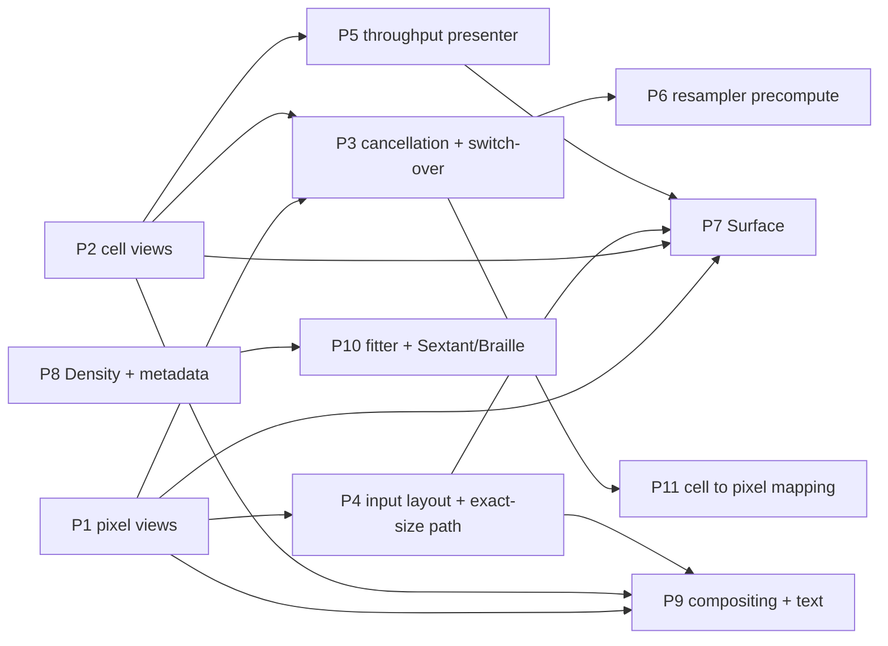

# Architecture roadmap after M1: M2–M7

- Status: **M2–M6 implemented (not committed); M7 proposed**
- Date: 2026-09-25, updated 2026-09-26 after M6
- Supersedes the "After M1" table in [phase-0-plan.md](history/phase-0-plan.md)
- Background: [architecture-audit.md](history/architecture-audit.md),
  [architecture-proposal.md](history/architecture-proposal.md), M1 results in
  [development-status.md](development-status.md)

## 1. Purpose

TRend's goal is to be a general-purpose terminal renderer: anything that can
produce a framebuffer should be able to use TRend as its terminal output.
That includes images, video, 2D and 3D renderers, games, procedural effects,
WebGL, and HTML. The application owns rendering, time, input, and experience.
TRend owns turning pixels into terminal output.

M1 proved the pipeline shape. This document records what the implementation
and measurements revealed, and sets the order of the next four milestones
based on that evidence rather than on the original Phase 0 sketch.

```text
source (app-owned) ──► PixelBuffer / borrowed view ──► CellEncoder ──► CellView ──► backend (ANSI)
```

## 2. What M1 proved

| Claim | Evidence |
| --- | --- |
| The staged pipeline reproduces the existing renderer exactly | `tests/pipeline_equivalence.rs`: 2,880 cases give identical cells, dimensions, and generations. More than 1 MB of ANSI output matches byte for byte across all four color modes |
| The tests would catch a regression | Deliberate breakages were each caught: removing the alpha-coverage clamp, transposing dither coordinates, and dropping grid scaling of pan (differential test); changing the old renderer (golden tests) |
| The pipeline isn't tied to 1×2 half-block pixels | `tests/quadrant_encoder.rs`: the same source covers the same cells with 40×40 square pixels (HalfBlock) and 80×40 pixels of aspect 1:2 (Quadrant). Changing `CellAspect` changes the result. Quadrant resolves detail HalfBlock can't |
| Terminal geometry is data, not code | `RasterSpec` (viewport × `SubcellGrid` × `CellAspect`) is the only place pixel size and pixel aspect come from |
| An arbitrary renderer can use TRend as its output | `examples/procedural_source.rs`: a native renderer and a scaled app framebuffer with padded rows. Switching encoders needs no change to app code |
| The new path costs nothing for half-blocks | Within ±10% of the old renderer (§3) |
| The core stays dependency-free and the change is additive | `cargo tree` is empty; `renderer.rs`, `terminal.rs`, `ffi.rs`, and `trend.h` are byte-identical |

The design choice that held up best: **the `PixelBuffer` is the contract, and
there is no `RenderSource` trait.** Neither example needed a trait, and a
closure or a borrowed view is the simpler integration point.

## 3. M1 measurements

All numbers are from a release build on a Linux x64 cloud container. Treat
them as relative, not absolute. Byte counts are exact; CPU times vary with
hardware. Terminal throughput itself was not measured, because there was no
real terminal.

### 3.1 Old renderer vs. new pipeline (`examples/render_benchmark.rs`)

Source 1920×1080, Contain fit, dither 8, 30 iterations, time per frame.

| Filter | Viewport | `Renderer` | HalfBlock pipeline | Ratio | Quadrant pipeline | ANSI bytes (truecolor, first frame) |
| --- | --- | --- | --- | --- | --- | --- |
| Nearest | 80×24 | 162 µs | 161 µs | 0.99× | 816 µs | 69,237 |
| Bilinear | 80×24 | 242 µs | 249 µs | 1.03× | 961 µs | 69,535 |
| Area | 80×24 | 7.21 ms | 7.90 ms | 1.10× | 7.76 ms | 69,733 |
| Nearest | 200×60 | 1.08 ms | 1.02 ms | 0.94× | 5.89 ms | 431,038 |
| Bilinear | 200×60 | 1.63 ms | 1.58 ms | 0.97× | 6.33 ms | 431,322 |
| Area | 200×60 | 9.56 ms | 9.56 ms | 1.00× | 13.86 ms | 432,253 |

### 3.2 Per-stage cost of a real-time frame

This was an ad-hoc probe, not a repository example. An "application" draws an
animated full-screen gradient, so **every cell changes every frame**. That's the
worst case for the presenter.

| Per frame | 80×24 HalfBlock | 80×24 Quadrant | 200×60 HalfBlock | 200×60 Quadrant |
| --- | --- | --- | --- | --- |
| App draws into `PixelBuffer` | 8 µs | 17 µs | 59 µs | 107 µs |
| Encode | 6 µs | 361 µs | 43 µs | 2.2 ms |
| Exact-size frame through `ImageSource` (Stretch, Nearest) | 77 µs | 156 µs | 539 µs | 974 µs |
| `AnsiPresenter::present`, truecolor | 342 µs | 367 µs | 2.8 ms | 2.1 ms |
| ANSI bytes, truecolor | 72 KB (37.6 B/cell) | 73 KB | 456 KB (38.0 B/cell) | 458 KB |
| ANSI bytes, 256-color | 47 KB | 47 KB | 290 KB | 291 KB |
| Output rate at 60 fps, truecolor | 4.3 MB/s | 4.4 MB/s | 27.3 MB/s | 27.5 MB/s |

## 4. What the measurements revealed

### 4.1 Bottlenecks

| # | Finding | Evidence | Consequence |
| --- | --- | --- | --- |
| B1 | **Terminal output is the real-time limit.** Presenting costs more CPU than encoding, and the bytes exceed what most terminals sustain | 2.8 ms and 456 KB per full-change 200×60 frame; about 27 MB/s at 60 fps; about 38 bytes per changed cell, mostly two separate SGR color sequences | Presenter throughput matters more than encoder speed for real-time use. It can't be fixed by changing the default byte output, which is locked by the golden tests, so it needs an opt-in backend |
| B2 | **Exact-size frames are resampled anyway.** `ImageSource` evaluates every pixel through checked arithmetic and `Option`s, even for a 1:1 copy | 539 µs for what is effectively a 96 KB copy | GPU and framebuffer readbacks at the right size need a direct path. Encoders already accept strided views, so this can be zero-copy. General resampling also benefits from precomputed per-row and per-column source indices and weights |
| B3 | **Multi-color encoders need a better fitting algorithm.** Quadrant searches all partitions, using closures and iterators per cell | 50× HalfBlock's encode time (2.2 ms vs 43 µs) | Sextant (2×3) and Braille (2×4) will be worse unless they share a fast two-color fitting helper |
| B4 | **No way to split work.** The core is single-threaded (correctly), but offers no row-band or region split a host could parallelize | Structural | Needs sub-views. The core stays thread-free; hosts bring their own threads |

### 4.2 Correctness gaps

| # | Gap | Consequence |
| --- | --- | --- |
| G1 | **Only top-down, straight-alpha RGBA8 input.** Real framebuffers are often BGRA, sometimes bottom-up (OpenGL `glReadPixels`), sometimes premultiplied (most GPU output), and often carry junk alpha: X11 and GDI frames can have alpha 0 everywhere | Such a frame would currently render as **fully transparent**, or with wrong colors or upside down. This blocks the readback and web-content use cases |
| G2 | **The presenter's monochrome mode does encoding work.** It maps any glyph other than `▀`/`▄` to its foreground luminance | Quadrant, and any future encoder, degrades in monochrome |
| G3 | **The new path can't be cancelled.** Only `Renderer::render_to_slice_cancellable` checks for cancellation between rows | The old renderer can't be retired until the pipeline supports row-band cancellation |
| G4 | **Two parallel implementations exist**: `calculate_for_spec` vs `calculate_transformed`, and `sample_rgba` vs `sample_with_alpha_background` | Kept on purpose in M1 so the differential test compares independent code. Left in place longer, they're a risk that fixes land in one and not the other |
| G5 | **Public enums can't grow safely.** `RenderError` can't gain variants without breaking exhaustive matches. New enums (`EncodeError`) and enums about to grow (`PixelFormat`) aren't `#[non_exhaustive]` | Adding BGRA or new error cases later would break callers |

### 4.3 Structural gap: regions

Real applications show more than one thing. Examples: a 3D view beside a log
panel, a video pane inside a UI, split-screen, a minimap. Today each pane
needs its own `CellFrame` and its own presenter at its own origin. There's no
shared screen, no z-order, and no single diff. Regions are the missing
building block under multiple render targets, compositing, row-band
cancellation, and parallelism.

## 5. Principles carried forward

1. **Buffers are the contract.** A source is anything that fills a
   `PixelViewMut` or lends a `PixelFrameView`. Integration is by closure or
   borrowed view. There's no `RenderSource` trait, `Compositor` object, or
   scene graph until a concrete need appears.
2. **The core is dependency-free and thread-free.** Views make work
   splittable; hosts decide whether to use threads.
3. **Existing bytes and cells don't change by default.** Output-changing
   improvements are opt-in (new types or options), and the golden tests stay
   the gate.
4. **Convenience is built only from public parts.** Anything like `Surface`
   must be reproducible by a host using the lower-level API.
5. **Every performance claim has a benchmark.** Each milestone that targets
   speed adds or extends a measurable gate.

## 6. Missing pieces and their dependencies

| Piece | Needs | Enables |
| --- | --- | --- |
| **P1** Strided mutable and sub-rectangle pixel views (`PixelViewMut`, `sub`) | — | P3, P6, P7, P9, native rendering into regions |
| **P2** Cell sub-views and row bands (`CellViewMut::sub`, row splits) | — | P3, P5, P7, P9, multi-pane screens |
| **P3** Row-band cancellation and `Renderer` switch-over (fixes G3, G4) | P1, P2 | Retiring the old loop; one implementation |
| **P4** Input layout: BGRA, row order, alpha mode on borrowed views, plus the exact-size encode path (fixes G1, part of B2) | P1 (shares the view type) | Readbacks, P7, web content |
| **P5** Opt-in throughput presenter: combined SGR, synchronized updates, region presenting, byte statistics (B1) | P2, for regions | Real-time output, P7 |
| **P6** Resampler precomputation (rest of B2) | Stable `ImageSource` after P3 | Cheaper scaled mode |
| **P7** `Surface` convenience: spec + buffers + encoder + presenter, resize/draw/encode/present | P1, P2, P4, P5 | Pleasant integration for external renderers |
| **P8** `Density` encoder and encoder glyph requirements (fixes G2) | — | Capability-driven encoder choice |
| **P9** Pixel-level compositing (`blend_over`) and cell-level text overlays | P1, P2, P4 (premultiplied alpha) | HUDs, labels, sprites over 3D or video |
| **P10** Shared two-color fitting helper, then Sextant and Braille (B3) | — (P8 for metadata) | More encoders at real-time speed |
| **P11** Cell-to-source-pixel mapping for input | P3 (single geometry implementation) | Interactive sources: games, UI, web |



P1 and P2 are the roots: nearly everything that makes TRend more than a
single-image renderer depends on them.

## 7. Deliberately outside TRend

| Concern | Owned by | How it connects to TRend |
| --- | --- | --- |
| Graphics APIs (wgpu, OpenGL, Vulkan, DirectX, Metal) | Application | Reads back pixels and lends a `PixelFrameView` with its stride, format, row order, and alpha mode |
| GPU synchronization, async mapping, double buffering | Application | Keeps the mapped memory alive for the duration of the borrow |
| 3D scenes, cameras, depth buffers, meshes, materials | Application | Renders into a `PixelViewMut` at the size and pixel aspect from `RasterSpec` |
| Browser engines (CEF, WebKit, Servo, headless Chromium) | A separate host program, out of tree | BGRA off-screen frames or a decoded screencast, plus input mapping via P11 |
| Game loops, frame pacing, input handling | Application | Calls TRend once per frame and drops frames when the terminal is behind |
| Windowing, raw terminal mode, alternate screen, size queries | Application, or the optional `trend-term` crate | Supplies the viewport and `CellAspect` |
| Image and video decoding | `trend-*` adapter crates | Produce views or `PixelBuffer`s |
| Font rasterization for text drawn as pixels | Application, or a future optional `trend-draw` | Text *as terminal cells* is TRend's (P9) |
| Threads and async runtimes | Application | Splits work with P1/P2 views |
| Audio | Application | Uses TRend's timing helpers only |
| Pixel graphics protocols (kitty, sixel, iTerm2) | A future optional backend crate | Would consume pixels instead of cells. `Surface` keeps the pixel buffer available so this needs no redesign |

## 8. Revised roadmap

### M2: views, input layout, and switch-over

> M2a and M2b are implemented.

M2 becomes **one implementation that can take any framebuffer**. It has two
checkpoints, so the additive API and the behavior-preserving refactor land
separately.

**M2a, additive:**

- **P1:** `PixelViewMut` (strided, from `PixelBuffer::view_mut` or a caller's
  `&mut [u8]`), `sub(rect)` on pixel views, and row bands.
- **P2:** `CellViewMut::sub(rect)` and row splits, backed by a private stride,
  with no change to the encoder trait signature.
- **P4:** input layout on borrowed views:
  - `PixelFormat::Bgra8`;
  - row order (top-down or bottom-up);
  - alpha mode (straight, premultiplied, or ignore);
  - a new constructor, with the existing `PixelFrameView::new` meaning today's
    layout.

  Encoders and `ImageSource` read through one pixel accessor. Also: a
  documented exact-size path that encodes a borrowed view directly with no
  copy.
- **G5 housekeeping:** `#[non_exhaustive]` on `EncodeError` and `PixelFormat`
  before anything external depends on them.

**M2b, switch-over (behavior-preserving):**

- **P3:** `ImageSource` gains row-band rendering with cancellation.
  `Renderer`'s five methods become a facade over `ImageSource` + dither +
  `HalfBlock`. `calculate_transformed` delegates to `calculate_for_spec`, and
  the duplicate sampler goes.

**Exit criteria:**

- all golden and differential tests unchanged, including cancellation
  goldens;
- a new test matrix proves that BGRA, bottom-up, premultiplied, and
  ignored-alpha views each encode to the same cells as the equivalent RGBA
  view;
- region encoding into a shared `CellFrame` works;
- the benchmark shows no regression over 10%.

**Not in M2:** presenter changes, new encoders, `Surface`, compositing.

### M3: real-time throughput and capability policy

> **M3 outcome (implemented).** Measurement changed the plan; see
> [benchmarks.md](benchmarks.md).
>
> - **P5 was replaced.** Formatting, not the protocol, dominated presenter
>   CPU, so M3 made the existing presenter 3.5–4.6× faster with identical
>   bytes instead of adding an opt-in presenter. Combined SGR (about 8% fewer
>   bytes), synchronized updates, region presenting, and byte statistics move
>   to M4.
> - **P6 was narrowed.** Precomputation wasn't needed: Nearest and Bilinear
>   were division-bound and got exact shortcuts. Area is bound by memory
>   bandwidth and stays unchanged.
> - **P8 is done.** Encoder requirements and the `Density` encoder, plus
>   regional dithering and the realistic workload benchmark.

- **P5:** an **opt-in** throughput presenter, built as new options or a new
  type. The existing `AnsiPresenter` keeps its byte-exact output. It adds:
  - one combined foreground/background SGR per cell;
  - synchronized-update wrapping (DEC mode 2026);
  - presenting a region of a shared screen at an origin;
  - per-frame byte statistics;
  - faster number formatting.
- **P6:** resampler precomputation, with cells and bytes held identical by the
  golden tests.
- **P8:** the `Density` encoder (replacing the monochrome remap for new
  code), and glyph-requirement metadata on encoders so hosts can choose an
  encoder from `TerminalCapabilities`.
- A realistic-scene benchmark: bytes and CPU per frame for a mostly static
  scene with a moving object, not only the worst case.

**Exit criteria:**

- a measured byte and CPU reduction on the full-change and realistic scenes
  (targets set from M3's first measurements, not guessed now);
- the old presenter's goldens unchanged;
- Quadrant in monochrome renders correctly via `Density`.

**Not in M3:** lossy byte-budget or perceptual-threshold presenting. Measure
first; consider it as M3.5 if needed.

### M4: integration ergonomics

> **Additions from M3's measurements:**
>
> - **Opt-in output options**, with the default bytes unchanged:
>   - combined foreground/background SGR;
>   - synchronized-update wrapping (DEC mode 2026);
>   - presenting a `CellView` region at an origin;
>   - per-frame byte statistics.
>
>   These belong with `Surface`, which wraps the presenter.
> - **Documented host caching for static images** (render once, reuse the
>   cells with `CellFrameCache`), since Area can't get meaningfully faster.

- **P7:** `Surface`. It owns a `RasterSpec`, `PixelBuffer`, `CellFrame`,
  encoder, and presenter, and offers:
  - `resize(viewport)`;
  - `draw(|target, spec| …)` for native rendering;
  - `encode_from(view)` for readbacks, taking the exact-size path when sizes
    match and resampling otherwise;
  - `present_at(row, column)`.

  It's built only from public parts; an example reimplements it by hand.
- **P11:** mapping cell coordinates back to source pixels, for mouse input.
- A **software-3D example**: a tiny rasterizer with its own depth buffer,
  living in the example.
- **Readback recipes** in docs, out of tree, so their dependencies never touch
  the workspace:
  - wgpu: 256-byte-aligned rows, BGRA or RGBA;
  - OpenGL: bottom-up rows;
  - CEF off-screen rendering: BGRA with dirty rectangles.

**Exit criterion:** the procedural example rewritten on `Surface` in
noticeably less code, with identical output.

> **M4 outcome (2026-09-25).** Delivered as planned, with these decisions:
>
> - `encode_from` accepts only exact-size frames (zero-copy). Fitted input
>   is the separate `encode_image`: with non-square pixels, switching
>   silently by size would stretch one magic size instead of fitting it.
> - `Surface` presents positioned (at an origin, attributes restored), never
>   clears the screen, and writes to any `io::Write`.
> - Region presentation uses a crate-private "unknown" sentinel cell in the
>   presenter's memory rather than a redraw flag. This lets any subset of
>   cells be forgotten or redrawn, with identical bytes for full frames.
> - `source_damage` widens by one source pixel. An extra surface-pixel
>   margin was measured redundant over 240,000 random geometries and removed.
> - The procedural example met the exit criterion: rewritten on `Surface`,
>   byte-identical output. It went from 18 pipeline statements over seven
>   types to 9 statements on one type. The example's total size barely
>   changed, because it is mostly the app's own drawing.
> - The software-3D example and the readback recipes were not done. They
>   need no core API, and they move to M5 alongside the HUD example.
>
> Belongs in a future `trend-term` crate, not the core: raw mode, the
> alternate screen, size queries and SIGWINCH, mouse enable and parsing
> (SGR 1006, SGR-pixels 1016), DECRQM probing for mode 2026, and cell pixel
> size (`CSI 16 t`).

### M5: composition and encoders

> **Added from M4's measurements, first:** track the presenter's pen by the
> emitted color code instead of RGB. In 256- and 16-color modes, 75–82% of
> bytes on smooth images are sequences that change nothing. It changes the
> default output, so it needs new goldens and a deliberate decision: either
> make it the default with re-recorded goldens, or ship it as an
> `OutputOptions` flag first.

- **P9:** `blend_over` between pixel views (straight and premultiplied), then
  cell-level text overlays:
  - `put_str` into a `CellViewMut`;
  - a transparent color kind;
  - styles using the existing `attributes` byte.

  The color-kind extension must keep the C ABI layout.
- **P10:** a shared two-color fitting helper (luma split or 2-means) that
  first brings Quadrant near HalfBlock cost, then `Sextant` (2×3) and
  `Braille` (2×4).
- Optionally, graduating `GlyphMatch` from `experimental.rs`.

**Exit criteria:**

- a HUD-over-3D example;
- Sextant and Braille pass the same geometry proofs as Quadrant;
- Quadrant encoding within a benchmark-set bound.

> **M5 outcome (2026-09-25).** Every exit criterion met; details in
> [benchmarks.md](benchmarks.md).
>
> - **P10, measured first.** Quadrant's time was 85% fitting. An exact
>   rewrite (subset sums, a closed form for pairs, table popcounts,
>   reciprocal division) made it 3–4× faster with identical cells. Goldens
>   recorded from M4 beforehand prove the cells are unchanged. "Near
>   HalfBlock cost" was not reached, and can't be while keeping Quadrant's
>   exact output: it is still about 10× HalfBlock (1.3 ms vs 0.13 ms at
>   200×60). The bound set instead is at most 1.7 ms, 3× under M4.
> - **The shared fitter is a projection, not luma or 2-means.** Luma was
>   measured at 22–93% worse; projecting onto the axis between two
>   far-apart colors is within 0.03% of exhaustive. `Sextant` and
>   `Braille` use it and pass Quadrant's geometry proofs. Their glyph
>   tables are checked against Unicode character names.
> - **P9, without a transparent color kind.** Text is written into cells
>   after encoding (`text::put_str`), with `TextBackground::Keep` covering
>   what a transparent kind would have. Cell-level layering isn't needed,
>   so the C ABI's `Color` stays as it is. Attributes use the existing
>   byte and are now written by the presenter. `compose::blend_over`
>   handles pixel overlays and returns damage for `Surface::encode_region`.
> - **The M4 pen finding shipped opt-in**, as
>   `OutputOptions::compact_indexed_colors` (3–5× smaller indexed output,
>   same screen). Making it the default is an M6 decision.
> - **Also delivered:** the HUD-over-3D example (`hud_3d`, with the
>   software 3D from M4's list), readback recipes, and
>   `Surface::encode_from_region` for browser and compositor dirty
>   rectangles.
> - **Deferred:** graduating `GlyphMatch`. Nothing needs it yet, and the
>   fitter covers the multi-color cases.

### M6: defaults, FFI v2, and the terminal session

- **Output defaults.** Decide whether `compact_indexed_colors` (and
  possibly `combined_colors`) become the default before a 1.0 API. Doing
  so re-records the 256/16-color ANSI goldens, and the screen-model tests
  already prove the screen is identical.
- **FFI v2.** The Rust API has settled, so expose it as opaque handles:
  `Surface`, encoder selection, output options, regions, `put_str`, and
  `blend_over`. This also serves the CEF host in
  [readback-recipes.md](readback-recipes.md), which today has to be Rust.
- **`trend-term`, a separate optional crate:**
  - raw mode, the alternate screen, size queries, and resize signals;
  - mouse reporting (SGR 1006 and 1016) parsed into events that feed
    `Surface::cell_at_terminal`;
  - probing for mode 2026 support (DECRQM);
  - the cell pixel size query (`CSI 16 t`) for `CellAspect`.

  Every example still hard-codes its size, so this is the next usability
  step.
- **Release profile.** `opt-level = "s"` halves the fitters' speed.
  Measure the binary-size cost of `opt-level = 3`, or of per-function
  hints, before choosing.
- **Optional:** wide-character text layout (a width table, and a
  continuation cell the presenter skips), if a host needs CJK or emoji in
  overlays.

> **M6 outcome (2026-09-26).** M6 was re-scoped at its start to measure
> and validate before adding features; the evidence then decided what to
> build. Details in [benchmarks.md](benchmarks.md) and
> [development-status.md](development-status.md).
>
> - **The 30-FPS budget.** `examples/frame_budget.rs` measures video,
>   static photos, native 3D-like scenes, and GPU-style readbacks with
>   every encoder at 200×60 and 320×90. In steady state TRend uses at most
>   17% of 33.3 ms at 200×60 and 42% at 320×90 (Braille video), and
>   allocates nothing. Full-motion truecolor video writes 13–33 MB/s: the
>   terminal, not TRend's CPU, is the likely limit, and it is the one
>   stage not measured.
> - **Two bottlenecks fixed, bytes unchanged:** Bilinear resampling per
>   row (2.4×), and per-layout row decoders in encoders and `blend_over`
>   (HalfBlock and Density encode 5× faster, foreign layouts cost 3–5%
>   over TRend's own buffer). Video frames cost 33–67% less.
> - **Release profile.** `opt-level = 3` makes the block fitters 13–43%
>   faster for +0.4% library size (+18% for the media viewer).
>   Recommended; the profile is unchanged because it's a packaging
>   decision.
> - **Output defaults.** A 16-color overhead in `compact_indexed_colors`
>   was found and fixed; compact output is now cheaper than the default
>   everywhere and 1.7–5.4× smaller. Decision: opt-in now, default at the
>   next output-compatibility boundary (see [api.md](api.md)).
> - **FFI v2: designed, not built.** [ffi-v2-design.md](design/ffi-v2-design.md)
>   proposes about 16 functions over an opaque `Surface` handle. Freezing
>   it before a real C host exercises it would lock in guesses; v1 is
>   unchanged and now has a strict C11 consumer test.
> - **`trend-term`: designed, not built.**
>   [trend-term-design.md](design/trend-term-design.md) draws the line: the core
>   keeps capability policy and all output; raw mode, size, resize, input,
>   and probing go to an optional crate. The test viewer's hand-rolled
>   session layer is the evidence.
> - **End to end.** `examples/external-renderer`: a standalone renderer
>   with its own frame description, BGRA, bottom-up, premultiplied, padded
>   rows, encoded in place through one mapping function. Readback recipes
>   gained a layout table for common framebuffers.
> - **Deferred:** wide-character text (no host has asked).

### M7 (proposed): the terminal session and real-terminal throughput

Status, 2026-11: `trend-term` stage 1 is built (session, size and resize, keys, mouse,
timed writes) and the test viewer runs on it. Probing, the throughput measurements and the
decisions that follow from them are still open. The external-renderer host was left without
`trend-term` so that it measures the core alone.

M6 showed TRend's own cost fits the budget; what remains unknown is the
terminal. M7 builds the piece that makes TRend usable in a real terminal
and, with it, measures the terminal.

- **`trend-term`, stages 1–2** of [trend-term-design.md](design/trend-term-design.md):
  session enter/restore (including after a panic), size and resize, keys;
  then DECRQM 2026 and cell-pixel-size probing. Port the test viewer and
  the external-renderer example onto it.
- **Real-terminal throughput.** With `write_frame` timing, run the
  external renderer and `frame_budget` workloads in Windows Terminal,
  conhost, and at least two Unix terminals at 200×60 and 320×90. Record
  sustained MB/s and frame times.
- **Then decide, from those numbers:** a frame-drop policy for slow
  terminals, and whether lossy byte reduction (color tolerance, temporal
  thresholds) is needed at all.
- **Output-compatibility boundary.** If a version bump is planned, flip
  `compact_indexed_colors` (and consider `combined_colors` and
  `synchronized_updates`) with re-recorded 256/16-color goldens.
- **Optional, parallel:** FFI v2 stage 1 (a draft `trend_v2.h`, reviewed
  against one real C host) — not an implementation.

Exit criteria: the test viewer and one example run on `trend-term` on
Windows and Unix with no hand-rolled console code; measured throughput for
at least three terminals is in `benchmarks.md`; the core is unchanged
except where a measurement requires it.

### Unchanged tracks

- **Android MP4/H.264** remains independent of M2–M7. After M2 it can emit
  views directly.

## 9. Why this order

1. **M2 first, because it's the root of the graph.** Seven of the other nine
   pieces depend on P1 or P2, directly or through P3, and P4 fixes a real
   correctness gap. A
   whole class of inputs (BGRA, bottom-up, junk alpha) currently renders
   wrong, and those are exactly the readback and web-content cases TRend
   exists to serve. Building `Surface`, compositing, or region presenting
   before views and input layout would mean designing them around types that
   are about to change.
2. **The switch-over belongs in M2, not later.** Row-band cancellation needs
   row-band views, so P3 comes naturally once P1/P2 exist. Retiring the
   duplicates early removes the risk of fixes landing in only one of them.
   The M1 golden and differential tests make this refactor unusually safe
   right now.
3. **M3 before M4, because `Surface` wraps the presenter.** Building the
   convenience layer on the old presenter and then swapping it would change
   `Surface`'s options twice. Throughput is also the measured real-time limit.
4. **`Density` moves from M2 to M3.** On review, it's capability policy (which
   encoder suits which terminal), not data model. It fits beside the encoder
   metadata and the presenter work, and the monochrome gap only affects the
   new encoders, which nobody depends on yet. This keeps M2 focused.
5. **Resampler precomputation moves into M3.** It's throughput work. Doing it
   after the switch-over means optimizing one implementation instead of two.
6. **Compositing and new encoders go last.** They depend on everything above
   (views, alpha modes, the fitting helper), and neither blocks the first
   real-time or readback integrations.

### Changes made during this review

Compared with the proposal discussed before this document:

- Split M2 into M2a (additive) and M2b (switch-over).
- Moved the `Density` encoder from M2 to M3, together with encoder glyph
  metadata.
- Added resampler precomputation (P6) to M3.
- Added `#[non_exhaustive]` housekeeping to M2a (G5).
- Made the exact-size encode path part of M2 rather than `Surface`, because
  it's a property of views, not of the convenience layer.
- Added a realistic-scene benchmark to M3, so presenter targets come from
  measurement.
- Deferred lossy presenting (byte budgets, perceptual thresholds) until M3's
  measurements exist.

## 10. Alternative: M3 before M2

**Choose this if a visible real-time demo, or terminal throughput, becomes the
immediate priority** over readback correctness and regions.

What it would look like:

- the opt-in presenter with combined SGR, synchronized updates, and byte
  statistics, for **whole frames only**;
- resampler precomputation, applied to both implementations or to
  `ImageSource` only;
- `Density` and encoder metadata.

What you give up or defer:

- region presenting, which needs P2, so it would be added in a follow-up once
  M2 lands;
- resampler work done before the switch-over either touches two
  implementations or leaves the old one slower;
- readback correctness (G1) stays open longer, so BGRA, bottom-up, and
  junk-alpha sources still need conversion by the host.

This order is safe but costs some rework. The presenter API would be designed
before cell views exist, and its region entry points added afterwards.

## 11. Open questions

1. **Input layout representation:** resolved in M2a with a
   `#[non_exhaustive]` `PixelLayout` descriptor and
   `PixelFrameView::from_layout`.
2. **Premultiplied alpha:** M2a converts to straight on read. Resolved in
   M5: `blend_over` works in straight alpha, because writable surfaces are
   straight, and premultiplied sources are read through the same conversion.
3. **Throughput presenter shape:** resolved in M4 as `OutputOptions` on
   `AnsiPresenter`, whose default reproduces today's bytes.
4. **Does `PixelFrameView` keep its timestamp?** Media timing belongs to media
   frames; removing it is a breaking change that should wait for a deliberate
   API revision.
5. **Default output options:** resolved in M6. `compact_indexed_colors`
   stays opt-in and becomes the default at the next output-compatibility
   boundary; the evidence (same screen, fewer bytes, less CPU) is in
   [benchmarks.md](benchmarks.md).
6. **How fast are real terminals?** Open. It decides whether TRend needs a
   frame-drop policy or lossy output. M7 measures it.
