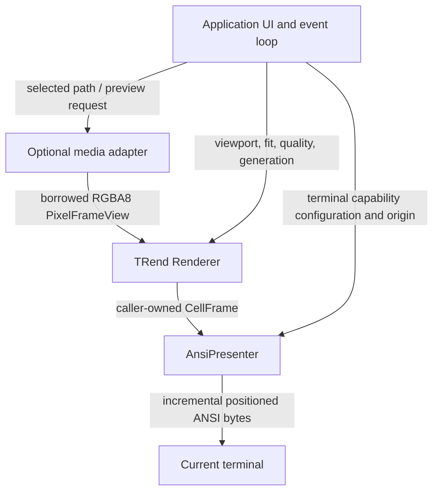

# Application Integration

> **TRend is a renderer that applications consume, not an application that
> consumes the terminal.**

TRend accepts decoded RGBA8 frames, scales them into terminal cells, and can
encode those cells as incremental ANSI output. It is not a file manager, media
browser, input loop, layout engine, terminal emulator, or full media player.

## Ownership

| Caller application owns | TRend owns | Optional adapter owns |
| --- | --- | --- |
| menus, navigation, selection, layout | RGBA validation and scaling | encoded-media parsing |
| input and event loop | cell generation and quality mode | bounded decoded storage |
| terminal size and capability policy | fit, alignment, zoom, pan | frame timing metadata |
| scheduling, threads, cancellation token | ANSI cell diffing and encoding | platform decoder calls |
| preview start/stop and decoder lifetime | no hidden thread or event loop | no application UI |

The core never opens a media file, reads keyboard input, probes a terminal,
creates a UI, or starts playback. An application may use only the core with its
own RGBA source, or link the focused adapters it needs.

## Integration Flow



For an image preview, the application decodes once, borrows the resulting
frame, and rerenders it when the preview viewport changes. For GIF or video, it
selects or decodes a frame for the application clock, then passes that same
RGBA8 view through the renderer. A resize changes `Viewport`; it does not
require reopening the source.

Rust applications call `Renderer::render_with_options_into` with a reusable
`CellFrame`. C-compatible applications can call `trend_render_rgba8` or
`trend_render_rgba8_ex` into caller-owned `TrendCell` storage. The C ABI accepts
RGBA8 and intentionally does not expose decoder-specific objects.

To embed ANSI inside application chrome, use:

```rust
let bytes = presenter.present_at(&frame, preview_row, preview_column);
terminal.write_all(bytes)?;
```

`present_at` uses a 1-based caller-selected origin and never clears cells
outside the frame. Existing `present` remains the full-screen convenience path
and clears on geometry changes.

Applications that want one operation can use `AnsiPresenter::render_at()` with
a `PositionedRenderRequest`. Its nested `RenderRequest` carries viewport width,
height, fit, and generation; the positioned request adds 1-based row and
column. The caller still owns the rectangle and reusable `CellFrame`; TRend
assigns no thumbnail, preview, fullscreen, or widget meaning to it.

An external master clock, including an audio library, can call
`PreviewSession::frame_at_media_time(position)` and render the returned borrowed
RGBA view. `MediaFrame::requested_timestamp` records the requested clock time;
`presentation_timestamp` records the actual decoded source timestamp. Audio
playback and audio-device policy remain entirely external.

## Terminal Capabilities

The application selects `TerminalCapabilities` explicitly:

- `TrueColor`, `Ansi256`, `Ansi16`, or `Monochrome` color;
- Unicode half-blocks or ASCII fallback.

`TerminalCapabilities::from_env_values` is conservative best-effort
classification, not active probing. Environment variables can be absent,
incorrect, or altered by SSH/tmux, so production applications should expose a
configuration override. `NO_COLOR` is honored by the helper. Core rendering is
independent of ANSI support: applications may consume `CellFrame` directly and
present it through another backend.

Terminal dimensions always come from the caller. The renderer validates a
nonzero viewport and performs no font, character-width, or terminal-emulator
assumption. Applications are responsible for reserving enough rows and columns
for their own borders and controls.

## Media Adapters and Platforms

| Component | Windows | Linux/macOS | ARM/ARM64/Termux | Runtime dependency |
| --- | --- | --- | --- | --- |
| `trend` core | Supported; tested x64 | Debian WSL2 x64 tested | ARM/ARM64 not tested | Rust standard library only |
| PNG/JPEG adapter | Supported; tested x64 | Debian WSL2 x64 tested | Not tested | focused decoder crates |
| GIF adapter | Supported; tested x64 | Debian WSL2 x64 tested | Not tested | focused GIF crate |
| MP4/H.264 adapter | Media Foundation; tested x64 | No backend | No backend | Windows system Media Foundation |

The non-Windows video package builds an explicit unsupported-platform stub.
Portable video previews therefore require a future platform adapter behind the
same timestamped borrowed-RGBA contract. There is no global FFmpeg executable
or GUI requirement, and adding one is not part of this experiment.

WebP remains unsupported. Phase 6B, sharpening, and experimental glyph paths
remain excluded. FAST/BALANCED/QUALITY continue to map to nearest, bilinear,
and area sampling respectively.

## Python Laboratory

The stdlib-only Python TUI under `examples/python-tui` is an example
consumer. Python owns its terminal session, panels, keys, selection, resize
polling, capability options, latest-request queue, and bridge process lifetime.
The optional Rust bridge owns one selected decoder and invokes the real TRend
pipeline. The bridge has no UI policy and is not part of the core library.

This arrangement proves that an unrelated application can request a preview
without becoming TRend. It does not make Python a TRend dependency: consumers
may use Rust, the C ABI, or another binding/bridge.

## Limitations

- ANSI cursor addressing is required by the example TUI; the renderer itself
  can still produce cells for non-ANSI presentation backends.
- Active terminal capability probing is intentionally absent.
- Video is currently Windows-only and silent.
- The Python bridge protocol is a test interface, not a versioned public ABI.
- Linux, macOS, ARM, ARM64, Termux, SSH, tmux, and screen require CI and device
  validation before production support can be claimed.
- Very small terminals may show application controls without requesting media;
  the renderer is not asked to draw into an invalid or overlapping viewport.