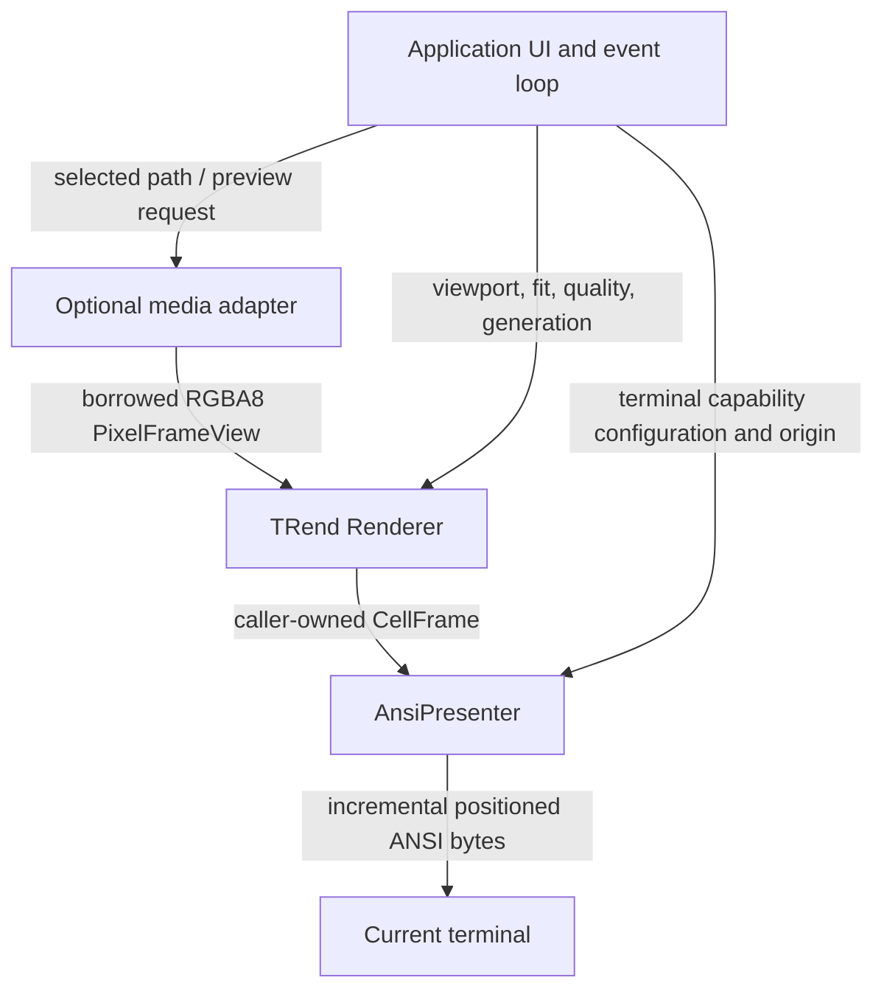

# Architecture

> **TRend is a renderer that applications consume, not an application that
> consumes the terminal.**

TRend accepts decoded RGBA8 frames, scales them into terminal cells, and can
encode those cells as incremental ANSI output. It is not a file manager, media
browser, input loop, layout engine, terminal emulator, or full media player.

## The Crates

```text
your program
   |-- trend-term   (optional)  the terminal: size, resize, keys, mouse, restore
   |-- trend-3d     (optional)  draws 3D into pixels
   |-- trend-text   (optional)  draws scaled text into pixels
   |-- trend-media / -image / -animation / -video (optional)  decode files into pixels
   `-- trend        (core)      pixels -> cells -> ANSI bytes
```

Every optional crate depends on the core; the core depends on nothing, and no optional crate is
needed to use it. Two paths lead through the core:

- **Pixels you draw.** `Surface` owns a pixel buffer for the terminal's size, runs a
  `CellEncoder` (half block, quadrant, sextant, Braille or density) over what changed, and
  presents the difference. This is the path for games, visualisations, 3D and other renderers'
  framebuffers.
- **Pictures you decode.** `Renderer` fits, scales and letterboxes a decoded frame into
  half-block cells for an `AnsiPresenter`. This is the path the media crates and the C ABI use.

Both end in the same cells and the same presenter.

## Ownership

| Caller application owns | TRend owns | Optional adapter owns |
| --- | --- | --- |
| menus, navigation, selection, layout | RGBA validation and scaling | encoded-media parsing |
| input and event loop | cell generation and quality mode | bounded decoded storage |
| terminal size and capability policy | fit, alignment, zoom, pan | frame timing metadata |
| scheduling, threads, cancellation token | ANSI cell diffing and encoding | platform decoder calls |
| preview start/stop and decoder lifetime | no hidden thread or event loop | no application UI |

The core never opens a media file, reads keyboard input, probes a terminal,
creates a UI, or starts playback. An application may use only the core with its
own RGBA source, or link the focused adapters it needs.

## Integration Flow



For an image preview, the application decodes once, borrows the resulting
frame, and rerenders it when the preview viewport changes. For GIF or video, it
selects or decodes a frame for the application clock, then passes that same
RGBA8 view through the renderer. A resize changes `Viewport`; it does not
require reopening the source.

Rust applications call `Renderer::render_with_options_into` with a reusable
`CellFrame`. C-compatible applications can call `trend_render_rgba8` or
`trend_render_rgba8_ex` into caller-owned `TrendCell` storage. The C ABI accepts
RGBA8 and intentionally does not expose decoder-specific objects.

To embed ANSI inside application chrome, use:

```rust
let bytes = presenter.present_at(&frame, preview_row, preview_column);
terminal.write_all(bytes)?;
```

`present_at` uses a 1-based caller-selected origin and never clears cells
outside the frame. Existing `present` remains the full-screen convenience path
and clears on geometry changes.

Applications that want one operation can use `AnsiPresenter::render_at()` with
a `PositionedRenderRequest`. Its nested `RenderRequest` carries viewport width,
height, fit, and generation; the positioned request adds 1-based row and
column. The caller still owns the rectangle and reusable `CellFrame`; TRend
assigns no thumbnail, preview, fullscreen, or widget meaning to it.

An external master clock, including an audio library, can call
`PreviewSession::frame_at_media_time(position)` and render the returned borrowed
RGBA view. `MediaFrame::requested_timestamp` records the requested clock time;
`presentation_timestamp` records the actual decoded source timestamp. Audio
playback and audio-device policy remain entirely external.

## Terminal Capabilities

The application selects `TerminalCapabilities` explicitly:

- `TrueColor`, `Ansi256`, `Ansi16`, or `Monochrome` color;
- Unicode half-blocks or ASCII fallback.

`TerminalCapabilities::from_env_values` is conservative best-effort
classification, not active probing. Environment variables can be absent,
incorrect, or altered by SSH/tmux, so production applications should expose a
configuration override. `NO_COLOR` is honored by the helper. Core rendering is
independent of ANSI support: applications may consume `CellFrame` directly and
present it through another backend.

Terminal dimensions always come from the caller. The renderer validates a
nonzero viewport and performs no font, character-width, or terminal-emulator
assumption. Applications are responsible for reserving enough rows and columns
for their own borders and controls.

## Media Adapters and Platforms

| Component | Windows | Linux | Android | Runtime dependency |
| --- | --- | --- | --- | --- |
| `trend` core | Tested (x64) | Tested (x64, Debian under WSL2) | Device-checked by the maintainer | Rust standard library only |
| `trend-term` | Run by the maintainer | Tested in a pseudo-terminal | Not tested | `crossterm` |
| `trend-3d`, `trend-text` | Run by the maintainer through the examples | Tested (x64) | Not tested | none besides the core |
| PNG, JPEG, GIF (BMP and TIFF decoders are included) | Tested | Tested | Images and animation device-checked | Rust decoder crates |
| WebP (feature `webp`) | Experimental; tested | Experimental | Not tested | `image-webp` |
| MP4/H.264 | Tested, through Media Foundation | No backend | Not implemented | Windows system decoders |
| WebM and MKV | Experimental (features `webm`, `mkv`) | Experimental (`linux-webm`, `linux-mkv`, `linux-h264`) | Not implemented | Media Foundation; libvpx and OpenH264 |
| AVI and MOV | Experimental (features `avi`, `mov`) | No backend | Not implemented | Media Foundation |

macOS and ARM desktops have not been tested. There is no FFmpeg
dependency and no audio decoding. FAST, BALANCED and QUALITY in the tools map to nearest,
bilinear and area sampling. [development-status.md](development-status.md) records what has
been verified and when; the platform pages under [platforms/](platforms/windows.md) have the
details.

## Python Laboratory

The stdlib-only Python TUI under `examples/python-tui` is an example
consumer. Python owns its terminal session, panels, keys, selection, resize
polling, capability options, latest-request queue, and bridge process lifetime.
The optional Rust bridge owns one selected decoder and invokes the real TRend
pipeline. The bridge has no UI policy and is not part of the core library.

This arrangement proves that an unrelated application can request a preview
without becoming TRend. It does not make Python a TRend dependency: consumers
may use Rust, the C ABI, or another binding/bridge.

## Limitations

- The core never asks the terminal anything. Capabilities come from environment variables or
  from the program; `trend-term` reports the size, and the cell's pixel size where the terminal
  gives it, but does not yet probe for features.
- Unicode block, sextant and Braille characters depend on the terminal's font. `Density::ASCII`
  works everywhere.
- Video is silent, and which containers work depends on the platform and the features built in.
- The Python bridge protocol is a test interface, not a versioned public ABI.
- macOS, ARM desktops, SSH, tmux and screen have not been validated.
- Very small terminals may show an application's controls without room for media; that is the
  application's layout to handle.
